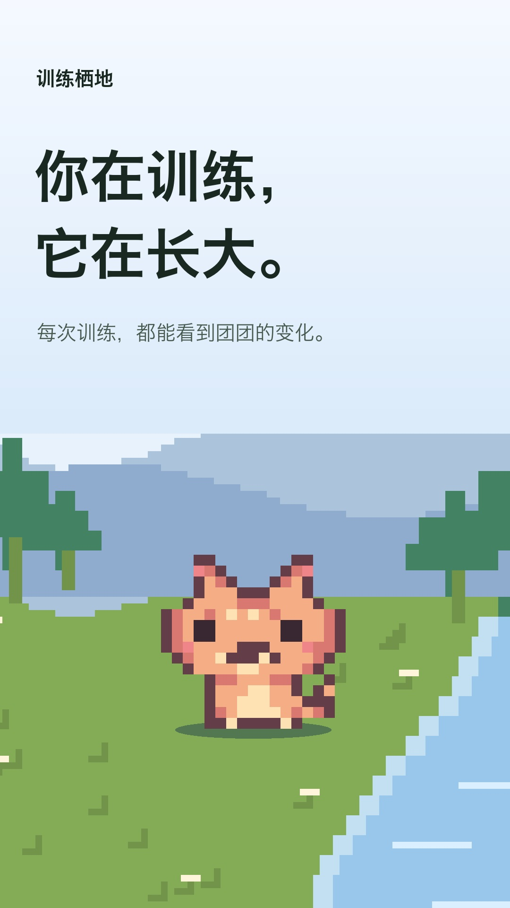

# 训练栖地

把训练排进日程，用训练记录陪像素宠物成长。面向使用 iPhone 的大学生，提供训练计划、计时、手动记录、回顾，以及十种宠物和五种栖息地。

## 四项交付

| 交付内容 | 入口 | 内容与验收方式 |
| --- | --- | --- |
| 需求确定 | [需求评估工作与结论](docs/delivery-requirements.md#requirements-assessment) | 说明竞品评估、横向人群分析、纵向场景、JTBD、痛点清单、MVP 决策与首测设计，并对照当前实现范围。 |
| 产品原型 | [原型说明](design-demos/README.md) · [日常使用](design-demos/ios-prototype.html) · [新用户引导](design-demos/new-user.html) | 两个可离线交互的 HTML 原型，覆盖训练闭环、领养、成长和栖息地；定稿标签为 `prototype-v1.2`。 |
| MVP | [iPhone 安装与使用](ios/README.md) · [Xcode 工程](ios/TrainingHabitat.xcodeproj/project.pbxproj) | SwiftUI、SpriteKit 原生 iOS 个人版，支持训练计划、计时、记录、回顾、宠物成长、本机存储和提醒。 |
| 产品介绍视频 | [观看或下载成片](design-demos/product-film/vertical/训练栖地-竖屏短片.mp4) · [视频说明与时码](design-demos/product-film/vertical/README.md) | 约 81 秒，1080×1920、60 fps；包含像素新手引导、iPhone 实机操作、中文字幕、配乐和触点音效。 |

建议先看视频，再体验新用户引导和日常原型，最后查看需求与 MVP 源码。GitHub 中的 HTML 文件显示源码；点击仓库的 **Code → Download ZIP**，解压后用浏览器打开 HTML 即可操作。视频页面可播放时直接观看，也可以下载原始文件。

[](design-demos/product-film/vertical/训练栖地-竖屏短片.mp4)

## 运行 MVP

用 Xcode 打开 `ios/TrainingHabitat.xcodeproj`，为 `TrainingHabitat` 和 `TimerActivity` 选择同一个 Personal Team，再运行到 iOS 26 或更新版本的 iPhone。完整步骤见 [iPhone 安装说明](ios/README.md)。仓库交付的是源码工程，安装需要自己的 Apple 签名。

当前主 App 使用本地手动训练记录；Apple 健康读取保留为独立 `HealthCheck` 自检目标。个人版规则以 [需求与交付范围](docs/delivery-requirements.md) 和 [iOS 说明](ios/README.md) 为准。早期方案和浏览器演示记录了不同阶段的设计，原型中的设备导入、提醒和时间推进使用模拟数据。

## 验证

在仓库根目录运行：

```sh
PYTHONDONTWRITEBYTECODE=1 python3 -m unittest discover -s tests
node --test design-demos/tests/training.mjs
node design-demos/tests/browser.mjs
sh ios/scripts/check.sh
PYTHONDONTWRITEBYTECODE=1 python3 -m unittest discover -s design-demos/product-film/vertical
python3 design-demos/product-film/verify-film.py design-demos/product-film/vertical/训练栖地-竖屏短片.mp4 --portrait-timeline design-demos/product-film/vertical/timeline.json
```

链接与原型构建检查使用 Python 标准库；浏览器验证需要本机 Chrome，iOS 规则检查需要 macOS Swift 命令行工具，视频测试需要 Pillow、NumPy，成片验证需要 FFmpeg、FFprobe。可通过 `PIXEL_CHROME`、`FFMPEG`、`FFPROBE` 指定可执行文件路径。

宠物三阶段对照和升阶过渡截图见 [成长验证图](design-demos/previews/growth-verification/growth-audit.png)。视频成片已随仓库提供；重新剪辑所需的原始 MOV 素材位于制作机器的临时目录，未包含在本次交付中。
